```{r setup, include=FALSE}

knitr::opts_knit$set(root.dir = "~/orov_out", options(scipen=999))
require(tidyverse)
require(flextable)
require(data.table) #use datatables instead of frames
require(gtsummary)

theme_set(theme_bw()) # set general theme 

source(here::here("2_scripts", "00_functions.R")) # source the functions from their specific location 


# load objects 
l_orov <- readRDS(here::here("1_data", "05_clean_data","orov_out_descriptive_analysis_objects.RData"))

l_map <- readRDS(here::here("1_data","05_clean_data","orov_out_case_reported_paho.RData"))

names(l_map) <- c("br_am", "br_ce", "br_pb", "br_pe", "br_mg", "br_es", "br_rj", "br_sp", "pe_lor", "pa_dar")

l_ct_data <- readRDS(here::here("1_data","05_clean_data", "l_ct_data.RData"))

# clean variable names 


# Remove everything after \r\n OR the text "yes/no/not known"
replacement_vector <- str_remove(l_orov$attr_manaus$dictionary$variable_description, "\\r?\\n.*|\\s*yes/no/not known")

# remove white spaces 
replacement_vector <- str_trim( replacement_vector,side = "both")

# introduce special characters
replacement_vector <- str_replace(replacement_vector, "umol/L", "µmol/L")

replacement_vector <- setNames(replacement_vector, l_orov$attr_manaus$dictionary$variable_name)

#set some values manually
replacement_vector["ethnicity"] <-  "Ethnicity"
replacement_vector["education"] <-  " Education"
replacement_vector["case_type"] <- "Type of case"
replacement_vector["household_contact"] <- "Household contact"
replacement_vector["housing_location"] <- "Housing location"
replacement_vector["immuno"] <- "Immunosuppression"
replacement_vector["year"] <- "Year"
replacement_vector["pregnancy_trimester"] <- "Pregnancy trimester"
replacement_vector["n_comorb"] <- "Comorbidities" 
replacement_vector["sex"] <- "Sex"
replacement_vector["other_sx"] <- "Other symptoms"
replacement_vector["complication"] <- "Complication"
replacement_vector["compl_life_threat"] <- "Life-threatening complications"
replacement_vector["organ_impairment"] <- "Organ impairment"
replacement_vector["compl_onset"] <- "Time between complication and symptoms onset"
replacement_vector["final_outcome"] <- "Highest care level     "
replacement_vector["department"] <- "Department"
replacement_vector["consult_onset"] <-  "Time between consultation and symptoms onset"
replacement_vector["orov_dx_pcr"] <- "Positive RT-PCR test"
replacement_vector["orov_dx_nab"] <- "OROV-specific neutralizing antibodies"
replacement_vector["orov_dx_elisa"] <- "Positive ELISA test"
replacement_vector["time_sx_to_pcr"] <- "Days from symptom onset to positive RT-PCR test"
replacement_vector["time_sx_to_nab"] <- "Time between symptoms onset to NAB"
replacement_vector["time_sx_to_elisa"] <- "Time between symptoms onset to ELISA"
replacement_vector["time_sx_to_igg"] <- "Days from symptom onset to positive IgG test"
replacement_vector["time_sx_to_igm"] <- "Days from symptom onset to positive IgM test"
replacement_vector["age"] <- " Age (years)"
replacement_vector["age_cat"] <- " Age category"
replacement_vector["co_inf_other"] <- "Other coinfection"
replacement_vector["sx_length"] <- "Overall duration of symptoms in days"
replacement_vector["sx_length_acute"] <- "Length of symptoms - acute phase"
replacement_vector["haemoglobin_lab_cat"] <- "Haemoglobin range"
replacement_vector["haematocrit_lab_cat"] <- "Haematocrit range"
replacement_vector["wbc_lab_cat"] <- "White blood cells range"
replacement_vector["neutrophils_lab_cat"] <- "Neutrophils range"
replacement_vector["lymphocytes_lab_cat"] <- "Lymphocytes range"
replacement_vector["platelets_lab_cat"] <- "Platelets range"
replacement_vector["creatinine_lab_cat"] <- "Creatinine range"
replacement_vector["alt_lab_cat"] <- "ALT range"
replacement_vector["ast_lab_cat"] <- "AST range"
replacement_vector["organ_impairement"] <- "Organ impairment"
replacement_vector["orov_confirmation"] <- "OROV diagnosis"
replacement_vector["dialysis"] <- "Kidney replacement therapy"
replacement_vector["abdominal_pain"] <- "Abdominal pain"
replacement_vector["warning_signs"] <- "At least one warning sign"
replacement_vector["two_ws"] <- "Two warning signs"
replacement_vector["pregnancy_weeks"] <- "Gestational age (weeks)"
replacement_vector["ethnicity2"] <- "Ethnicity"
replacement_vector["n_sx"] <- "Number of symptoms"
replacement_vector["other_sx_bin"] <- replacement_vector["other_sx"]
replacement_vector["n_haemorrhagic"] <- "Number of haemorrhagic complications"
replacement_vector["respiratory"] <- "Respiratory complications"
replacement_vector["renal_compl"] <- "Renal complications"
replacement_vector["hepatic"] <- "Hepatic complications"
replacement_vector["cardiac"] <- "Cardiac complications"
replacement_vector["n_ws"] <-  "Number of warning signs"
replacement_vector["n_sx_cat"] <- "Number of symptoms"
replacement_vector["complication2"] <- "Complication type"
replacement_vector["ethnicity3"] <- "Self-reported race/ethnicity"
replacement_vector["still_birth_ct"] <- "Stillbirth fetal samples ct values"
replacement_vector["haematocrit_lab_elevated"] <- "Elevated haematocrit"
replacement_vector["platelets_lab_low"] <- "Thrombocytopenia"
replacement_vector["alt_lab_elevated"] <- "Elevated ALT"
replacement_vector["n_co_inf"] <- "Co-infections"
replacement_vector["compl_bin"] <- "Severe disease temporally associated with OROV infection"
replacement_vector["crp_lab_cat"] <- "CRP range"
replacement_vector["esr_lab_cat"] <- "ESR range"
replacement_vector["bilirubin_lab_cat"] <- "Bilirubin range"
replacement_vector["creatinine_lab_cat"] <- "Creatinine range"
replacement_vector["creatinine_lab_elevated"] <- "Elevated creatinine"
replacement_vector["lymphocytes_lab_low"] <- "Lymphopenia"
replacement_vector["sx_recurrent"] <- "Recurrent symptoms (biphasic disease)"
replacement_vector["sero_igm"] <-"Positive OROV-specific IgM serum"
replacement_vector["sero_igg"] <-"Positive OROV-specific IgG serum"
replacement_vector["tourniquete"] <- "Positive tourniquet test"
replacement_vector["diarrhea"] <- "Diarrhoea"
replacement_vector["ct_available"] <- "Available Cts"
replacement_vector["no_organ_support"] <- "No reported organ support"
 
# disaggregated race data
n_afro <- paste(l_orov$l_ethnicity_disagg$Afrodescendiente, "Afrodescendiente")
n_preta <- paste(l_orov$l_ethnicity_disagg$Preta, "Preta")
n_blanco <- paste(l_orov$l_ethnicity_disagg$Blanco, "Blanco")
n_branca <- paste(l_orov$l_ethnicity_disagg$Branca, "Branca")

# n preg cohort
n_preg<- sum(l_orov$orov_clean$pregnancy=="Yes", na.rm = T)

# n with lab test done
n_lab <- nrow(l_orov$df_lab)

# n with CT data
n_ct_available <- sum(l_orov$orov_clean$ct_available=="Yes")

# n with CT data & age data
n_ct_age <- l_orov$orov_clean |>
  filter(!is.na(orov_serum_ct),!is.na(age)) |>
  nrow()

n_ct_compl <-  l_orov$orov_clean |>
  filter(!is.na(orov_serum_ct), !is.na(complication2)) |>
  nrow()

n_ct_sx <- l_orov$orov_clean |>
  filter(!is.na(orov_serum_ct), !is.na(complication2), !is.na(time_sx_to_pcr)) |>
  nrow()

# n with time to PCR data
n_time_sx_pcr <- l_orov$orov_clean |>
  filter(!is.na(time_sx_to_pcr)) |>
  nrow()

# n with postive PCR over 5 days
n_time_sx_pcr_over_5_days <- l_orov$orov_clean |>
  filter(!is.na(time_sx_to_pcr),time_sx_to_pcr > 5) |>
  nrow()

# n with postive PCR over 7 days
n_time_sx_pcr_over_7_days <- l_orov$orov_clean |>
  filter(!is.na(time_sx_to_pcr),time_sx_to_pcr > 7) |>
  nrow()

# separate the pregnancy outcomes from the table 
tab1_preg <- l_orov$preg_site_tab
tab1_preg$table_body <- tab1_preg$table_body[-((nrow(tab1_preg$table_body)-8):nrow(tab1_preg$table_body)),] #remove adverse preg outcomes

tab2_preg <- l_orov$preg_site_tab
tab2_preg$table_body <- tab2_preg$table_body[(nrow(tab2_preg$table_body)-8):nrow(tab2_preg$table_body),] # only keep adverse events

# separate the lab values of interest from lab table 
tab2_lab <- l_orov$lab_tab

tab2_lab$table_body <- tab2_lab$table_body[(nrow(tab2_lab$table_body)-4):nrow(tab2_lab$table_body),] # only keep the abnormal lab results
s_tab4 <- l_orov$lab_tab

s_tab4$table_body <-  s_tab4$table_body[-((nrow(s_tab4$table_body)-4):nrow(s_tab4$table_body)),] # remove the abnormal lab results

# max sx onset until pos urine RT-PCR 
time_max_urine <- max(l_orov$orov_clean$time_sx_to_pcr_urine_fu,l_orov$orov_clean$time_sx_to_pcr_urine , na.rm = T)

# n and % with urine longer than 7 days 
n_time_sx_urine_pcr_over_7_days <- l_orov$orov_clean |>
  mutate(time_sx_to_pcr_urine_combined = pmax(time_sx_to_pcr_urine, time_sx_to_pcr_urine_fu, na.rm = T)) |>
  filter(!is.na(time_sx_to_pcr_urine_combined),time_sx_to_pcr_urine_combined > 7) |>
  nrow()

# denom 
n_time_sx_urine_pcr <- l_orov$orov_clean |>
  mutate(time_sx_to_pcr_urine_combined = pmax(time_sx_to_pcr_urine, time_sx_to_pcr_urine_fu, na.rm = T)) |>
  filter(!is.na(time_sx_to_pcr_urine_combined)) |>
           nrow()
n_time_sx_urine_pcr

# percentage 

prob_time_sx_pcr_over_7_days <- round(n_time_sx_pcr_over_7_days/n_time_sx_urine_pcr*100, digits = 0)

# median for first 5 days: 
median_ct_5_days <- l_orov$orov_clean |>
  filter(time_sx_to_pcr<=5, !is.na(orov_serum_ct))|>
  group_by(site2) |>
  summarise(
    median_ct = round(median(orov_serum_ct, na.rm = TRUE), digits=1),
    iqr = paste(round(range(orov_serum_ct, na.rm =T), digits = 1),collapse = "–"),
    .groups = "drop",
    n_ct = n()
  ) |>
  mutate(median_ct_iqr = paste0(median_ct, " (" ,iqr, ")"))

# number of samples in figure 5C 
n_fig5_c<- sum(median_ct_5_days$n_ct)

# median 
v_medians<- with(
  median_ct_5_days,
  setNames(median_ct_iqr,
    site2
  )
)

v_n_ct_5_days <- with(
  median_ct_5_days,
  setNames(n_ct,
    site2
  )
)
```



## Tables

::: {#thm-1}
Demographic and epidemiological characteristics stratified by site

```{r}
#

demo_site_tab <- tbl_stack(list(l_orov$demo_site_tab, tab1_preg), quiet = T)
  # stack pregnancy outcomes underneath


table_1a <- style_table(demo_site_tab, replacement_vector)
table_1a |>
    bold(i = c(1,4,11,15,23, 26, 30, 36, 37, 42,48,49), j = "label", part = "body") |>
    bg(i = c(1,4,11,15,23, 26, 30, 36, 37, 42,48,49), bg = "#DDDDDD", part = "body") |>
  footnote(i=c(15,17,19,length(table_1a$body$rowheights)- 6,length(table_1a$body$rowheights)-6, length(table_1a$body$rowheights)-4, length(table_1a$body$rowheights)-5), # ensures that it always matches to the last row
           j=c(1,1,1, 4,5,1,1), # column
           value=as_paragraph(c(
             "In sites where data on ethnicity were available, it was self-reported by participants based on the census definitions used in each country (more details in Supplementary Appendix)"
             ,paste(n_blanco, "and", n_branca),
                                paste(n_afro, "and", n_preta),
                                "Malaria", "Sepsis of urinary origin", paste0("Data shown for cohort of pregnant women only (n=",n_preg,")"))), 
           ref_symbols = c("*","2","3", "5", "6", "4", "4"),
           part = "body")
```
:::



::: {#thm-2}
Clinical presentation, complications, outcomes, and laboratory findings stratified by site

```{r}

clin_site_tab<- tbl_stack(list(l_orov$clin_site_tab,tab2_lab, tab2_preg), quiet = T)

table_2a <- style_table(clin_site_tab, v_replacement = replacement_vector)
table_2a  |> 
  add_body_row(values = c("Clinical presentation", rep("", ncol(table_2a$body$dataset) - 1))
  ) |>
  bold(i = c(1,60), j = "label", part = "body") |>
    bg(i = c(1,60), bg = "#DDDDDD", part = "body")|>
  footnote(i=c(26, 
               48,
               length(table_2a$body$rowheights)-7,
               length(table_2a$body$rowheights)-1), 
           j=c(1),
           value= as_paragraph(c("Other symptoms only counted once",
                                 "Complication categories are not mutually exclusive; individual participants may have more than one complication",
                                 paste0("Frequency shown for cohort of pregnant women only (n=",n_preg,")"),"Newborn with Down syndrome and death, threatened preterm labour (TPL) (33w) during OROV infection")),
           ref_symbols = c("2", "3", "4","5"),
           part = "body")|>
  footnote(i=c(72:76), j=c(1),
           value = as_paragraph(paste0("Frequency shown for participants with available laboratory values only (n=", n_lab,")")),
           ref_symbols = "5")
```
:::



## Supplementary tables

::: {#cor-1}
Distribution of participants by study site, region, state/provinces, and city

```{r}
municipalities_tab <- l_orov$municipalities_tab

s_table1  <- style_table(municipalities_tab, replacement_vector)
s_table1 |>
    bold(i = c(1,12,length(s_table1$body$rowheights)-4), j = "label", part = "body") |>
    bg(i = c(1,12,length(s_table1$body$rowheights)-4), bg = "#DDDDDD", part = "body") 
  
```
:::



::: {#cor-2}
Oropouche virus disease patients with reported haemorrhagic complications and organ involvement

```{r}

```
:::



::: {#cor-3}
Pregnant participants with OROV disease during pregnancy

```{r}

```
:::



::: {#cor-4}
Laboratory results by site

```{r}


s_table_4 <- style_table(s_tab4, replacement_vector)

idx <- which(grepl("range", s_table_4$body$dataset$label))

s_table_4  |>
  footnote(i=c(idx), # add footnote for all index
           j=c(1),
           value=as_paragraph("The normal reference laboratory values were as follow: ALT: F 7-30 U/L, M 10-55 U/L; AST: F 9-25 U/L, M 10-40 U/L; ESR: F ≥ 30 mm/h, M ≥ 20 mm/h; haematocrit: F 36.0-46.0% of RBCs, M 37.0-49.0% of RBCs; haemoglobin: F 120-160 g/dL, M 130-180 g/L; WBC: 4.5-11.0 x 109/L; Lymphocytes: 4.5-11.0 x 109/L; Neutrophils: 45-75% of WBCs; Platelets: 130-400 x 109/L; creatinine: F 0.50–1.10 mg/dL, M: 0.70–1.30 mg/dL ; bilirubin: 0.3–1.0 mg/dL; CRP: < 1.0 mg/dL (ranges for male and females are the same unless specified). For the four children in the dataset with available laboratory data, we used the age-stratified ranges specified by the Philadelphia Children’s Hospital.  "),
           ref_symbols = c("2"),
           part = "body")
```
:::



::: {#cor-5}
Complications by variables of interest

```{r}

compl_tab <- tbl_stack(list(l_orov$compl_tab,l_orov$s8_lab_tab), quiet = T)

s_table_5 <- style_table(compl_tab, replacement_vector)
s_table_5
```
:::



This is the reference table for adults to copy in S3 footnote

```{r}
lab_ref_tab<- l_orov$ref_lab_tab|>
  filter(str_detect(`Laboratory Test`, "ALT|AST|Hematocrit|Hemoglobin|Sed Rate|Leukocytes|Lymphocytes|Neutrophils|Platelets|WBC|Bilirubin - Total")) |>
  flextable() %>%
    fontsize(size = 11, part = "all") %>%
    flextable::font(fontname = "Times", part = "all") %>%
    theme_box() %>%
    bg(bg = "#EAEAEA", part = "header") %>%
    width(j = 1, width = 1.7) %>%
    align(align = "left", part = "all") %>%
    set_table_properties(width = 1, layout = "autofit")

lab_ref_tab
```

Sources:

<https://emedicine.medscape.com/article/2172316-overview?form=fpf>

<https://www.abim.org/Media/bfijryql/laboratory-reference-ranges.pdf>

<https://www.iapac.org/fact-sheet/normal-laboratory-values/>

There were `r l_orov$n_child` children in the dataset for which I then manually checked the if they were within, above or below range using the following reference values: <https://www.chop.edu/sites/default/files/2024-06/chop-labs-reference-ranges.pdf>



Extra table - values removed from main tables

```{r}

extra_tab <- l_orov$extra_tab

s_extra_tab <- style_table(extra_tab, replacement_vector)

s_extra_tab |>
  footnote(i=c(23), # add footnote for all index
           j=c(1),
           value=as_paragraph(c(paste(l_orov$paragraph_other_sx))),
           ref_symbols = c("2"),
           part = "body")

```



This is the table of median ct values stratified by site

```{r}
ct_tab <- l_ct_data$df_ct_time_site |>
    bind_rows(l_ct_data$df_ct_time_summary)|>
  mutate(across(ct_median:ct_q75, ~ round(.x, digits = 2)),
         ct_median_iqr = paste0(ct_median, " (", ct_q25,"-",ct_q75, ")")) |>
  select(site2,time_sx_to_pcr, ct_median_iqr, n_ct)|>
  arrange(site2, time_sx_to_pcr) 

ct_tab |>
  rename("Site" =site2, 
         "Time since symptom onset"= time_sx_to_pcr,
          "Median Ct (IQR)"= ct_median_iqr,
         "Total samples" = n_ct ) |>
  flextable() |>
  flextable::font(fontname = "Times", part = "all") %>%
    theme_box() %>%
    align(align = "left", part = "all") %>%
    set_table_properties(width = 1, layout = "autofit")

# obtain medians 
ct_medians <- ct_tab |>
  filter(is.na(time_sx_to_pcr)) |>
  pull(ct_median_iqr)
```



Table for median hospitalization time by severity

```{r}
l_orov$hospitalization_tab |>
    as_flex_table()|>
  flextable::font(fontname = "Times", part = "all") %>%
    theme_box() %>%
    align(align = "left", part = "all") %>%
    set_table_properties(width = 1, layout = "autofit")
```



Median CT values at each timepoint (\<24h, 1 day, 2 days, 3 days, 4 days, 5 days) overall and in no complications vs any complication are as follow.

```{r, warning=FALSE}
median_ct <- l_orov$orov_clean |>
  mutate(complication3 = ifelse(
    complication == "No reported complications", as.character(complication), "Any complication"
  )) |> # collapse
  group_by(time_sx_to_pcr, complication3) |>
  summarise(
    median_ct = round(median(orov_serum_ct, na.rm = TRUE), digits=1),
    iqr = paste(round(range(orov_serum_ct, na.rm =T), digits = 1),collapse = "–"),
    .groups = "drop"
  )

median_ct_overall <- l_orov$orov_clean |>
  group_by(time_sx_to_pcr) |>
  summarise(
    median_ct = round(median(orov_serum_ct, na.rm = TRUE), digits=1),
    iqr = paste(round(range(orov_serum_ct, na.rm =T), digits = 1),collapse = "–"),
    .groups = "drop"
  ) |>
  mutate(complication3= "Overall")

median_ct |>
  add_row(median_ct_overall) |>
  filter(!is.na(median_ct), !is.na(time_sx_to_pcr)) |>
  flextable() |>
  fontsize(size = 11, part = "all") %>%
  flextable::font(fontname = "Times", part = "all") %>%
  theme_box() %>%
  bg(bg = "#EAEAEA", part = "header") %>%
  width(j = 1, width = 1.7) %>%
  align(align = "left", part = "all") %>%
  set_table_properties(width = 1, layout = "autofit")
```



## Main figures

```{r}
#| label: fig-1
#| fig-cap: "Geographic distribution of Oropouche virus disease cases included in this study"

knitr::include_graphics("4_outputs/fig1_rev2.svg")

```

The map shows the geographic distribution of reported autochthonous OROV disease cases across Latin America and the Caribbean (indicated by colour gradients) and the cases included in this study (represented by circles) across eight sites in ten states or provinces in Brazil, Panama, and Peru. Total included cases are in black, severe (with haemorrhagic and/or organ involvement complications) are in red, and adverse pregnancy outcomes are in pink. By state/province: Espírito Santo (`r pull(l_map$br_es[1])` reported, `r pull(l_map$br_es[2])` included, (`r pull(l_map$br_es[3])` severe, `r pull(l_map$br_es[4])` pregnancy outcomes), Ceará (`r pull(l_map$br_ce[1])` reported, `r pull(l_map$br_ce[2])` included, `r pull(l_map$br_ce[3])` severe, `r pull(l_map$br_ce[4])` pregnancy outcome), Paraíba (`r pull(l_map$br_pb[1])` reported, `r pull(l_map$br_pb[2])` included, `r pull(l_map$br_pb[4])` pregnancy outcomes), Pernambuco (`r pull(l_map$br_pe[1])` reported, `r pull(l_map$br_pe[2])` included, `r pull(l_map$br_pe[4])` pregnancy outcomes), Amazonas (`r pull(l_map$br_am[1])` reported, `r pull(l_map$br_am[2])` included, `r pull(l_map$br_am[3])` severe), Rio de Janeiro (`r pull(l_map$br_rj[1])` reported, 40 included, `r pull(l_map$br_rj[3])` severe), Minas Gerais (`r pull(l_map$br_mg[1])` reported, 20 included), São Paulo (`r pull(l_map$br_sp[1])` reported, 1 included) in Brazil; Darién (`r pull(l_map$pa_dar[1])` reported, `r pull(l_map$pa_dar[2])` included, `r pull(l_map$pa_dar[3])` severe) in Panamá; Loreto (`r pull(l_map$pe_lor[1])` reported, `r pull(l_map$pe_lor[2])` included, `r pull(l_map$pe_lor[3])` severe, `r pull(l_map$pe_lor[4])` pregnancy outcomes) in Peru.

Data on reported cases are based on PAHO/WHO records derived from national reports, and political administrative boundaries shapefiles are from the public geoBoundaries database.^33,34^ In Brazil, PAHO reported cases originate from the Ministry of Health, which compiles data entered into the Notifiable Diseases Information System (SINAN). The higher number of cases from Pernambuco reflects additional laboratory-confirmed cases identified at Fiocruz Pernambuco that were not captured through the Unified Health System (SUS) system and therefore not yet included in SINAN.




```{r}
#| label: fig-2
#| fig-cap: "Symptoms stratified by age, risk factors, and complications"

knitr::include_graphics("4_outputs/fig2_grid_rev2.svg")

```

Symptoms of Oropouche virus disease cases stratified by age (A), presence of risk factors (B), and complications (C).

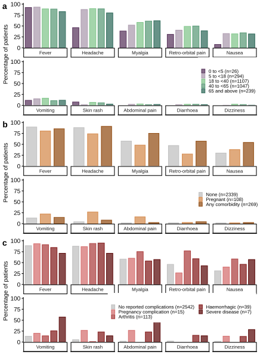



```{r}
#| label: fig-3
#| fig-cap: "Adverse pregnancy outcomes"

knitr::include_graphics("4_outputs/fig4_grid_rev2.pdf")
```

Adverse pregnancy outcomes, including abortions (orange), preterm births (grey), stillbirths (red), and neonatal outcomes (brown). Each case is represented by a unique letter. For each case, two points connected by a horizontal line indicate the gestational age at OROV disease presentation and at the time of the adverse outcome. A light-shaded closed point represents OROV disease, a dark-shaded closed point represents an adverse outcome, and an open point represents live birth. All pregnant women with adverse pregnancy complications were diagnosed by positive serum RT-PCR, except for I who was diagnosed by IgM positive.

Pregnant: Pregnant participant age and comorbidities; NA\_ Not available; NC:No comorbidities; GH: Gestational hypertension; GDM: Gestational Diabetes Mellitus; HTA: Hypertension; PPROM: Preterm Premature Rupture of Membranes; Sd: Syndrome; TPL:Threatened Preterm Labour; Nb: newborn

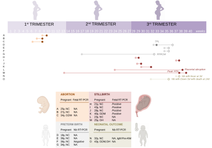{width="154mm" height="109mm"}



```{r}
#| label: fig-4
#| fig-cap: "Complications stratified by comorbidities, age, symptoms, and laboratory results"

knitr::include_graphics("4_outputs/fig4_grid_rev2.pdf")
```

Complications stratified by number of comorbidities (A), age (B), number of warning signs (i.e., abdominal pain, vomiting) (C), number of symptoms (D), length of symptoms (E), and laboratory results (F). F only includes participants with available laboratory data (n=116). \*Participants without elevated ALT, haematocrit or thrombocytopenia, but who could have had another abnormal test result.

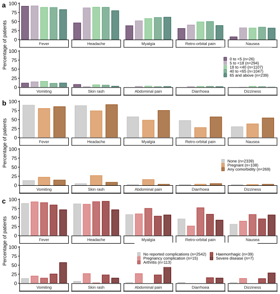



## Supplementary figures

::: {#lem-1}
Reported cumulative incidence of confirmed Oropouche (A), Zika (B), chikungunya (C), and dengue (D) virus cases for the study period.

The map shows the geographic distribution of incidence of confirmed arboviral disease cases across Latin America and the Caribbean (indicated by colour gradients)

Incidence rates were calculated from confirmed cases and population sizes reported by PAHO, and political administrative boundaries shapefiles were sourced from the public geoBoundaries database.

```{r}
knitr::include_graphics("4_outputs/fig_s1_rev2.svg")
```
:::




::: {#lem-2}
Distribution of symptoms for all included cases

```{r}

knitr::include_graphics("4_outputs/s2_rev2.svg")
```
:::

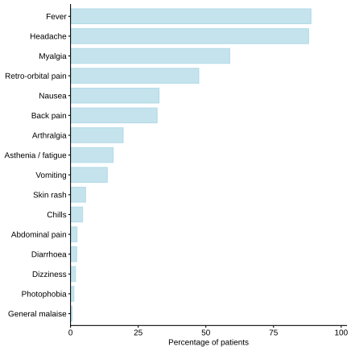{fig-align="center"}



::: {#lem-3}
Symptoms distribution by site in endemic and non-endemic regions

```{r}
knitr::include_graphics("4_outputs/s3_rev2.svg")
```
:::

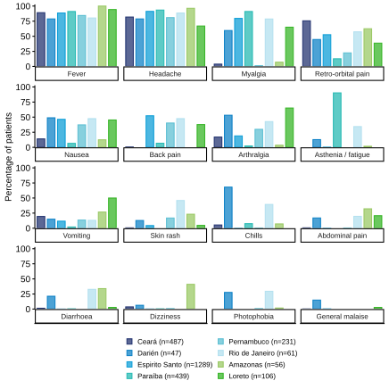{fig-align="center"}



::: {#lem-4}
Duration of symptom by site

```{r}
knitr::include_graphics("4_outputs/s4_rev2.svg")
```
:::

Duration of symptoms by study site. The y-axis is cut between 10 and 15 participants, and the lower part is scaled up for clarity. Of `r l_orov$n_sx_length` participants with available data, the median length of symptoms was 3 days (2, 7) with data on length of symptoms, of which `r l_orov$n_sx_length_over_5_days` had symptoms for longer than 5 days, `r  l_orov$n_sx_length_over_7_days` for longer than 7 days, and `r l_orov$n_sx_length_over_10_days` for longer than 10 days.

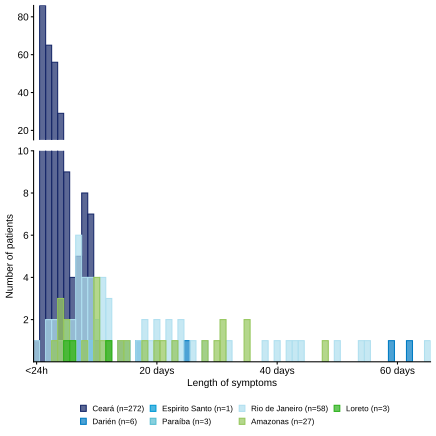{fig-align="center"}



::: {#lem-5}
Time from symptom onset to positive serum RT-PCR by site.

```{r}
knitr::include_graphics("4_outputs/s5_rev2.svg")
```
:::

Time from symptom onset to positive RT-PCR diagnostic test in serum by study site. The y-axis is cut between 50 and 70 participants, and the lower part of the graph is scaled up for clarity. Of `r n_time_sx_pcr` participants with available data, the median time until positive RT-PCR was 2 (1, 3), of which `r n_time_sx_pcr_over_5_days` had positive tests after more than 5 days, and `r n_time_sx_pcr_over_7_days` had positive tests after more than

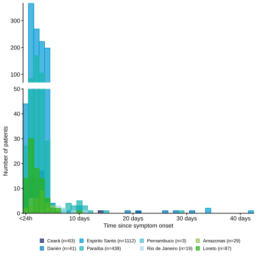{fig-align="center"}



::: {#lem-6}
Time from symptom onset to positive urine RT-PCR by site

```{r}
knitr::include_graphics("4_outputs/s6_rev2.svg")
```
:::

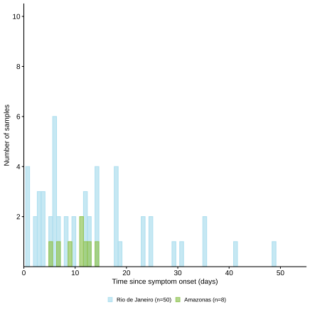{fig-align="center"}

Out of `r n_time_sx_urine_pcr` participants with available results, the median time from symptom onset to positive RT-PCR in urine was 14 days (IQR 8-25); `r n_time_sx_urine_pcr_over_7_days` (`r prob_time_sx_pcr_over_7_days`%) had a positive RT-PCR result in urine beyond seven days after symptom onset, with the longest observed interval being `r time_max_urine` days.



::: {#lem-7}
Cycle threshold (Ct) values of OROV RT-PCR in serum stratified by age

```{r}
knitr::include_graphics("4_outputs/s7_rev2.svg")
```
:::

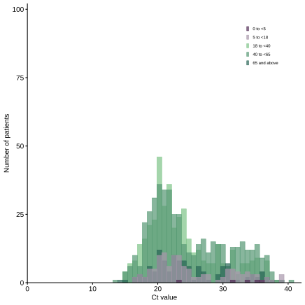

Raw Ct values were available for `r n_ct_available` individuals. Data are derived from `r n_ct_age`



::: {#lem-8}
Ct values by symptom duration by site

```{r}
knitr::include_graphics("4_outputs/s8_rev2.svg")
```
:::

Data were available for 42 participants.

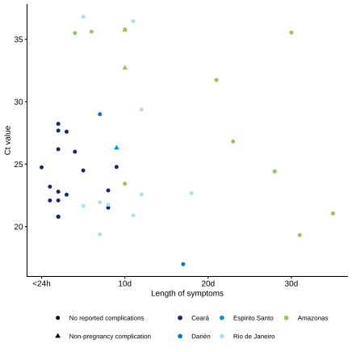



::: {#lem-9}
Cycle threshold (Ct) values of OROV RT-PCR in serum stratified by complications

```{r}
knitr::include_graphics("4_outputs/s9_rev2.svg")
```
:::

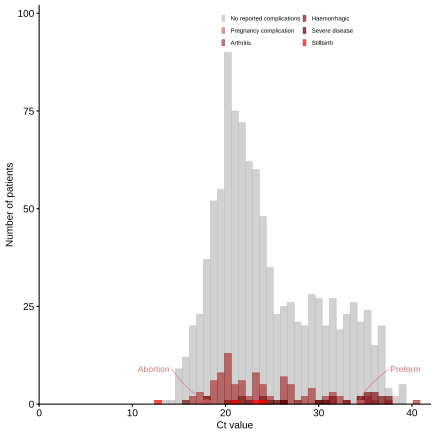

Raw Ct values were available for `r n_ct_available` individuals. Data are derived from `r n_ct_age`



::: {#-lem-10}
Distribution of Ct values for the first five days of symptom onset

```{r}
knitr::include_graphics("4_outputs/s10_rev2.svg")
```
:::

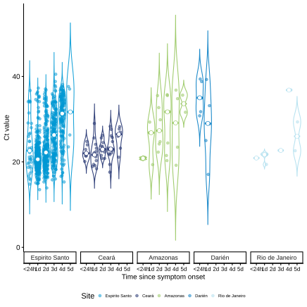

Raw Ct values were available for `r n_ct_available` individuals. Data for A and B are derived from `r n_ct_age`, and C from `r n_fig5_c` individuals from Ceará (n=`r v_n_ct_5_days[["Ceará"]]`), Darién (n=`r v_n_ct_5_days[["Darién"]]`), Espirito Santo (n=`r v_n_ct_5_days[["Espirito Santo"]]`), Rio de Janeiro (n=`r v_n_ct_5_days[["Rio de Janeiro"]]`), and Amazonas (n=`r v_n_ct_5_days[["Amazonas"]]`), for whom we also had comprehensive data on the timing of sample collection and symptom onset. Median Ct (IQR) values were as follow: `r v_medians[["Espirito Santo"]]` for Espirito Santo, `r v_medians[["Ceará"]]` for Ceará, `r v_medians[["Amazonas"]]` for Amazonas, `r v_medians[["Darién"]]` for Darién, and `r v_medians[["Rio de Janeiro"]]` for Rio de Janeiro.



::: {#lem-11}
Distribution of Ct values for the first eleven days of symptom onset.

```{r}
knitr::include_graphics("4_outputs/s11_rev2.svg")
```
:::

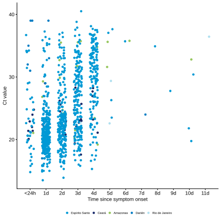

Data were available for `r n_ct_sx` individuals from Ceará, Darién, Espirito Santo, Rio de Janeiro, and Amazonas. Two individuals with time from symptoms onset to positive RT-PCR greater than 12 days, are not shown in the plot for clarity.
